# Lokibot Örneğine Tersine Mühendislik

Bu örneği MalwareBazaar'dan indirdim. Lokibot zaten bilinen bir zararlı yazılım ailesi, o yüzden başlangıç için iyi bir seçim. Bu yazıda böyle bir örneği nasıl unpack edip analiz edebileceğimizi göstermeye çalışacağım.

Orijinal dosya adı: **Invoice-pfi705-704-705.exe**

```yaml
File info: PE32 executable (GUI) Intel 80386 Mono/.Net assembly, for MS Windows
MD5: 6D156B57D3EED0F5C5B285437CB711BB
SHA1: D43605E4FD4BFC002728E49394FEB879B63B5D15
SHA256: A7A2151C314A329C44DF6D43C6F2757BD8994A5C6EC4C7AA1E9CB58713796B2D
```

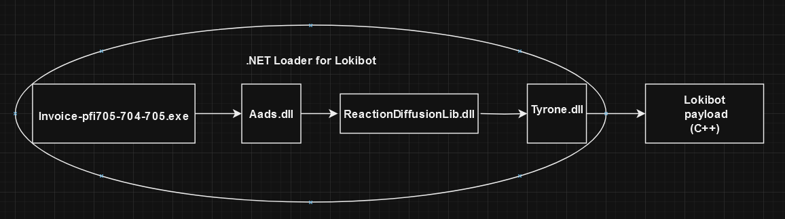

## Yara

```csharp
rule Lokibot_NET_Loader
 {
   meta:

      description = "Rule to detect a Lokibot Loader"
      author = "balpars"
      rule_version = "v1"
      malware_family = "Lokibot"

    strings:
        $str1 = "QuanhLyNhaThuoc"
        $unpack_sequence1 = {72 19 05 00 70 28 4F 00 00 0A 72 4F 05 00 70 20 00 01 00 00 14 14 17 8D 18 00 00 01 25 16 08 A2 6F 50 00 00 0A 75 1D 00 00 01 13 05}
        $unpack_sequence2 = {55 8B EC 57 83 EC 50 8D 7D AC B9 13 00 00 00 33 C0 F3 AB 83 3D 98 65 27 06 00 74 05 E8 5F C3 8F 6D 33 D2 89 55 C8 33 D2 89 55 D0 33 D2 89 55 E4 33 D2 89 55 CC 33 D2 89 55 D4 33 D2 89 55 C4 C7 45 E0 00 00 00 00 C7 45 DC 00 00 00 00 90 FF 15 98 6B 27 06 89 45 C0 8B 45 C0 89 45 D4}

    condition:

       uint16(0) == 0x5a4d and any of them
}
```

## Temel Statik Analiz

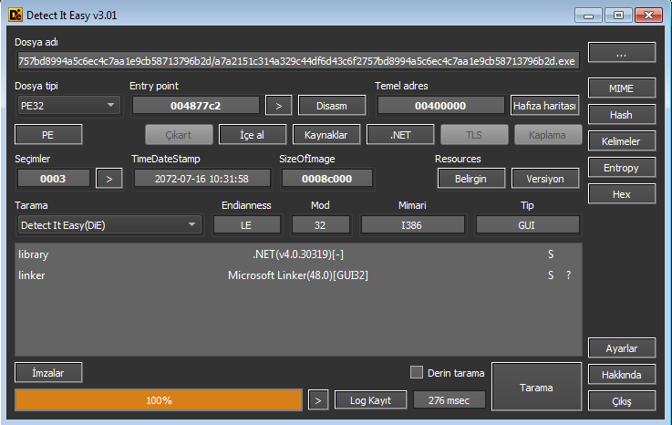

Elimizde TimeDateStamp'i değiştirilmiş bir .NET binary'si var.

Örneğin .NET framework kullandığını görüyoruz, yani dnSpy işimize yarayacak.

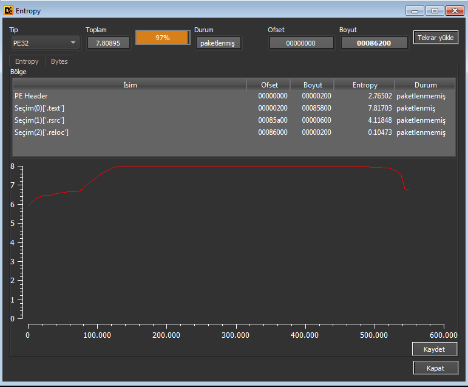

Binary'nin packed olduğunu görüyoruz.

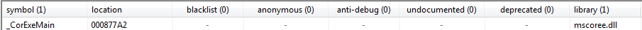

Tek import, .NET binary'lerinin çalışması için gereken mscoree.dll.

Kayda değer bir string görmedim, o yüzden buraya koymadım.

### Temel Statik Analiz Sonucu

- Dosya bir .NET binary'si
- Runtime'da bazı kısımlar unpack edilecek

## Temel Dinamik Analiz

Kendini bir klasöre kopyalayıp ardından siliyor. Hash'leri karşılaştırınca ikisinin aynı dosya olduğundan emin oluyoruz.

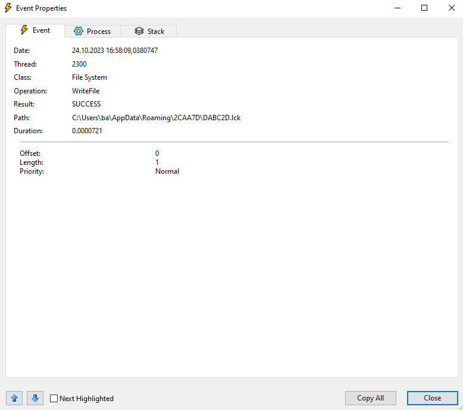

RSA klasörüne çok sayıda WriteFile yapılıyor. Bunun nedenini anlamak için daha detaylı incelemek gerekiyor.

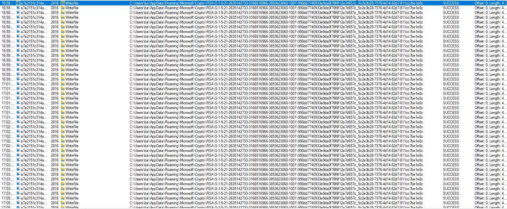

Dosyayı Noriben ile çalıştırınca ilginç sonuçlar çıktı:

```md
[CreateProcess] malware.exe:5832 > "%UserProfile%\Desktop\a7a2151c314a329c44df6d43c6f2757bd8994a5c6ec4c7aa1e9cb58713796b2d\malware.exe" [Child PID: 5060]

[CreateProcess] malware.exe:5832 > "%UserProfile%\Desktop\a7a2151c314a329c44df6d43c6f2757bd8994a5c6ec4c7aa1e9cb58713796b2d\malware.exe" [Child PID: 2324]

[CreateFile] malware.exe:2324 > %AppData%\2CAA7D\DABC2D.lck [File no longer exists]

[CreateFolder] malware.exe:2324 > %AppData%\2CAA7D

[RenameFile] malware.exe:2324 > %UserProfile%\Desktop\a7a2151c314a329c44df6d43c6f2757bd8994a5c6ec4c7aa1e9cb58713796b2d\malware.exe => %AppData%\2CAA7D\DABC2D.exe
```

Bellekte bunun bir stealer olduğunu gösteren pek çok ilginç string var: birçok tarayıcının adı ve bazı PowerShell komutları.

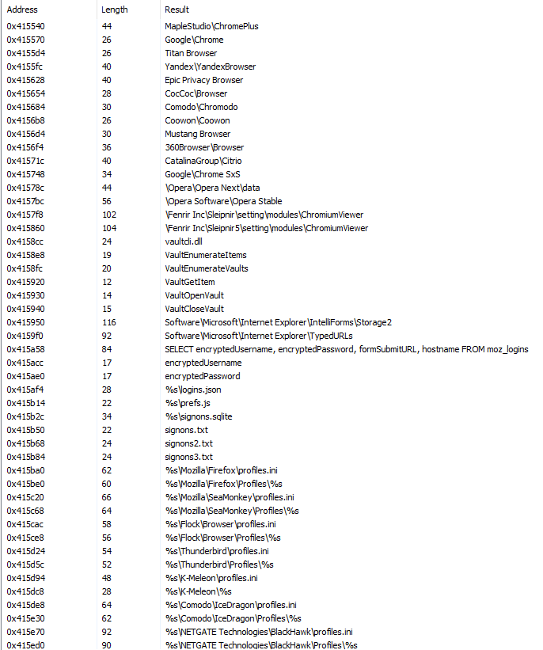

Burada daha birçok ilginç string var.

String'lerin arasında bir de IP adresi çıkıyor:
171[.]22[.]30[.]164/fresh/five/fre.php

Wireshark'ta da bu IP'ye yapılan bağlantı denemelerini görüyoruz.

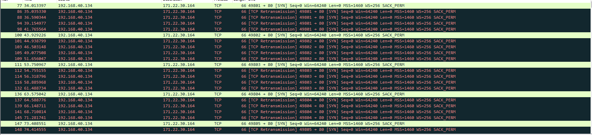

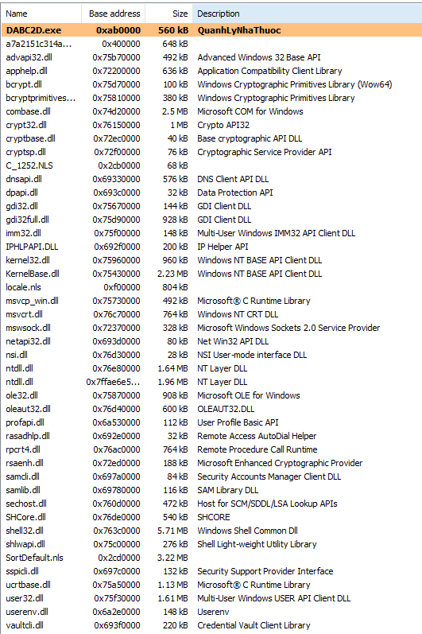

Yüklenen modüller de şüpheli.

RegShot ile baktığımızda, adı IP adresi olan bir key oluşturduğunu ve bu key'e daha önce kopyaladığı dosyanın klasör adıyla yolunu yazdığını görüyoruz.

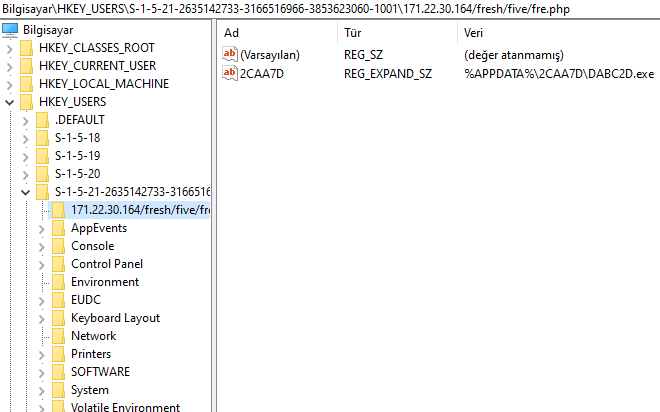

Zararlıyı çalıştırdıktan sonra Sysinternals Autoruns snapshot'larını karşılaştırdığımızda olağan dışı bir şey göremiyoruz.

Belirgin bir persistence mekanizması bulamadık. Daha fazla tahmin yürütmeden önce bu binary'yi daha derinlemesine incelememiz gerekiyor.

### Temel Dinamik Analiz Sonucu

- Örnek büyük ihtimalle bir stealer.
- C2 büyük ihtimalle 171[.]22[.]30[.]164
- Kendini kopyalayıp orijinal konumundan siliyor.

## İleri Dinamik Analiz (ya da birkaç breakpoint koyup zararlıyı çalıştırmak)

Kodun bir kısmının runtime'da unpack edileceğini biliyoruz.

Bu bir .NET binary'si olduğundan, .NET binary'lerini ve Unity oyunlarını reverse etmek için sıkça başvurulan dnSpy'ı kullanacağız.

---

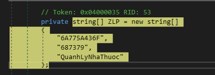

Program açılırken bir string oluşturuluyor; bu string programın ilerleyen kısımlarında da kullanılıyor. Yara kuralı yazarken işe yarayabilir.

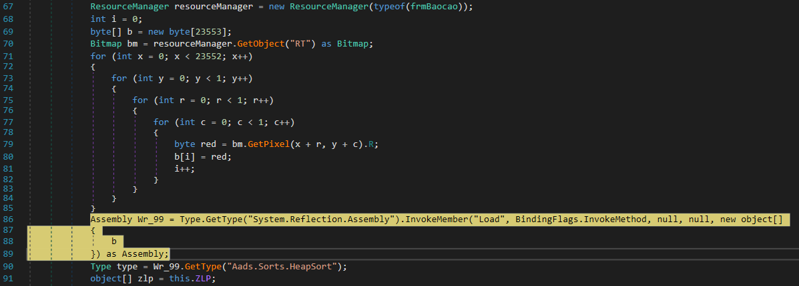

Bir byte dizisinden assembly yüklendiğini görüyoruz. C#'ta .NET executable'larına ve DLL'lerine assembly deniyor.

Bu son derece şüpheli bir davranış. Hemen alt satırda da Aads adlı bir DLL'den fonksiyon çağrıldığına dikkat edin.

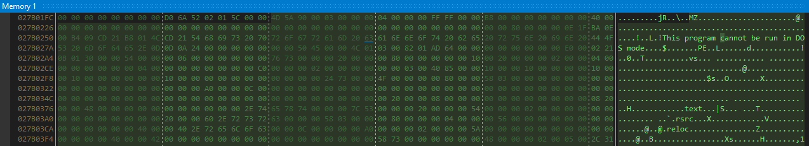

Memory dump'ta b değişkenini takip edince bunun bir executable olduğunu görüyoruz; demek ki bir unpacking rutini yakaladık. Analiz etmek için dump'ını alıyoruz.

Bunun, programın unpack ettikten sonra çağıracağı Aads.dll olduğunu tahmin edebiliriz. Debug çıktısına bakarak da doğrulayabiliriz.

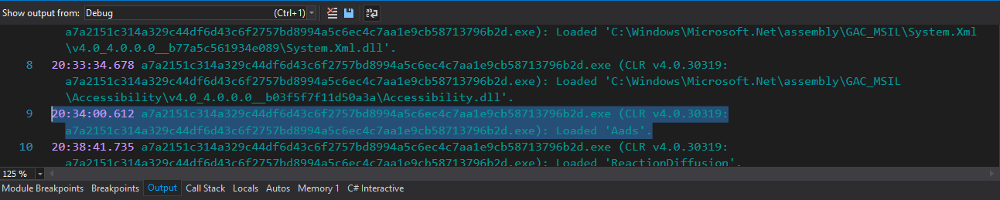

Step over yapınca dnSpy'ın debugger'ı duruyor; program kapanıp kendini yeni bir konumdan, yeni bir PID'le yeniden başlatıyor. Belli ki işin içinde anti-debugging var.

İlk binary'de anti-debug rutini yoktu, o hâlde unpack edilen DLL'de olmalı.

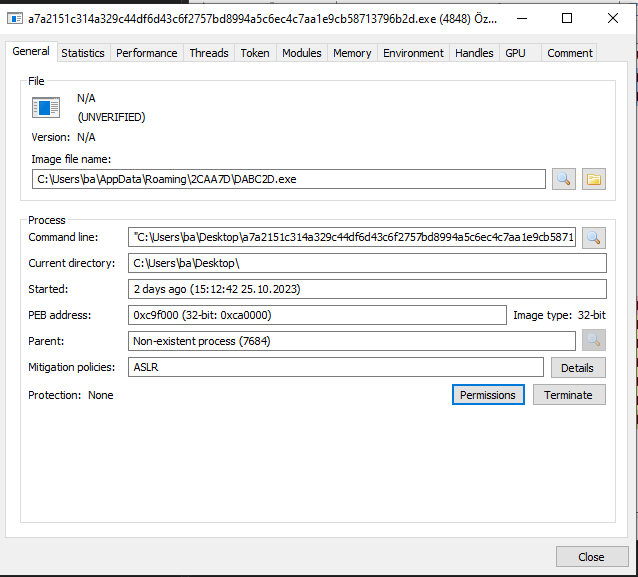

### İkinci Stage Analizi (Aads.dll)

```yaml
File info: PE32 executable (GUI) Intel 80386 Mono/.Net assembly, for MS Windows
MD5: aa18b22f39180498b7cfb1ac12e936d2
SHA1: ef30b16e85421c06c5dfad805a6d340d3c2253a4
SHA256: 248c028f540496c344f86669c97c5d66e34dfa580fee86ed15eaa88418907b3b
```

VirusTotal bu dosyayı da zararlı olarak işaretlemiş.

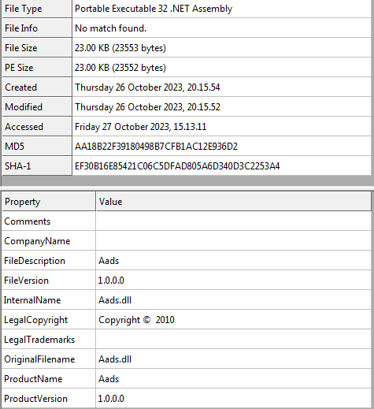

İlk dikkatimi çeken, burada büyük ihtimalle unpack edilecek bir binary daha olması.

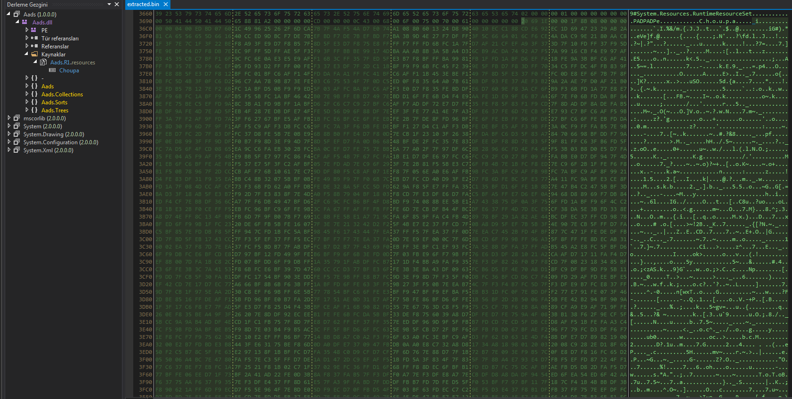

İlgimi çeken ikinci şey, önceki binary'nin debugger'ımızdan kaçmadan önce çağırdığı fonksiyon: “Aaads.heapsort”

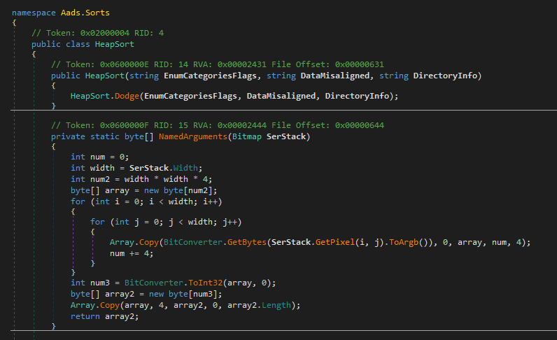

Burada “Dodge” fonksiyonunu çağırıyor. Bu fonksiyon da bir assembly yüklüyor, ardından programı kapatıyor.

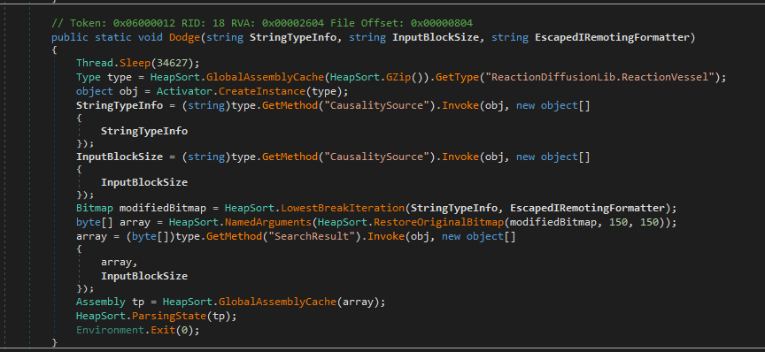

Üçüncü olarak da içerideki binary resource'u unpack eden rutinin nerede olduğuna bakmak istiyorum.

Resource burada byte dizisi olarak yükleniyor.

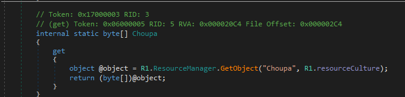

Burada da Gzip ile decompress ediliyor.

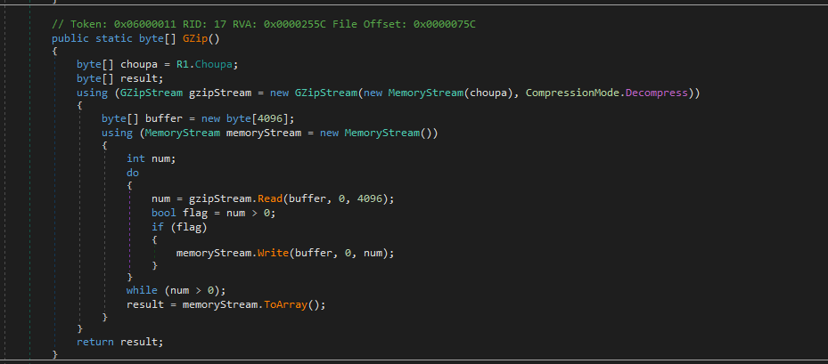

Verinin şifreli olmadığını, sadece sıkıştırıldığını görünce resource'u dnSpy'dan kaydedip 7-Zip ile açtım.

7-Zip “there are some data after the end of the payload data” uyarısı veriyor ama şimdilik bunu görmezden gelmekte sakınca yok.

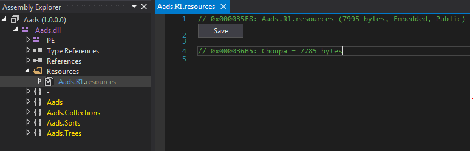

Decompress edilen dosyayı hex editörde açıyorum. “MZ” orada, yani elimizde bir executable daha var.

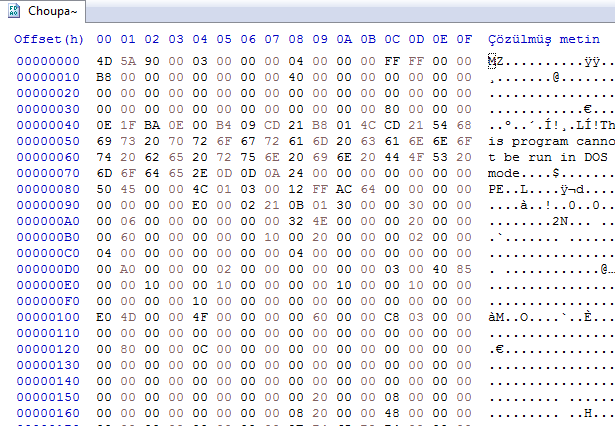

### İleri Dinamik Analizden İlk Sonuçlar

- Bu DLL, örneğe evasion yetenekleri kazandırıyor.
- Bir payload daha unpack ediliyor.
- Burada linked list, queue, tree gibi bazı veri yapıları tanımlanmış. Henüz kullanılmıyorlar; büyük ihtimalle bir sonraki binary kullanacak.

### Üçüncü Stage Analizi (ReactionDiffusionLib)

```yaml
File info: PE32 executable (GUI) Intel 80386 Mono/.Net assembly, for MS Windows
MD5: 37e82d3e2864e27b34f5fbacaea759c3
SHA1: a87024a466e052bff09a170bb8c6f374f6c84c32
SHA256: 53f2ad060cf771aa4f197df5789cee95959480c244a0b392bb450c8ce7311d77
```

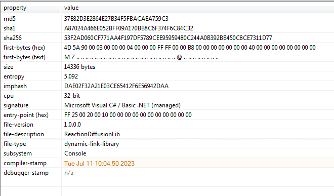

Bu dosya da bir DLL.

Üstelik .NET binary'si, yani dnSpy işimize yaramaya devam edecek.

String'lerine bakınca process injection yapılacağını tahmin ediyorum.

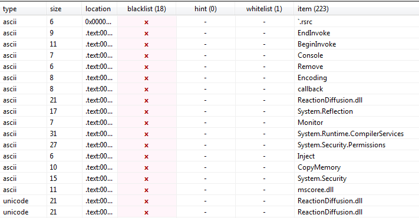

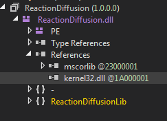

kernel32.dll'e referans verildiğini görüyoruz.

Inject adında bir fonksiyon var. String oluşturan bir fonksiyon da var; bu bir unpacking rutini.

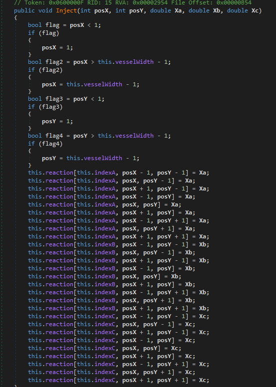

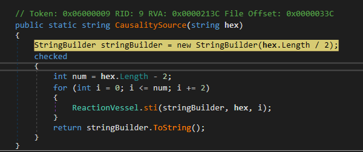

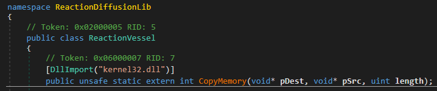

kernel32.dll ve CopyMemory fonksiyonu import ediliyor.

Daha ileri gitmeden önce örneği tekrar çalıştırıp bu DLL'lerin nasıl kullanıldığını takip edeceğim. DLL'leri çalıştırmadan önce incelediğimiz için breakpoint'leri nereye koyacağımızı artık biliyoruz.

### Üçüncü Stage Sonucu

- Bu binary başka kodlar da unpack edecek.

### Analize Devam

İlk breakpoint'e düşüp resource yüklendikten sonra Debug menüsünden Modules penceresini açmamız gerekiyor. Burada belleğe yüklenmiş modülleri görüyoruz. İstediğimiz modüle çift tıklayınca explorer panelinde görünüyor.

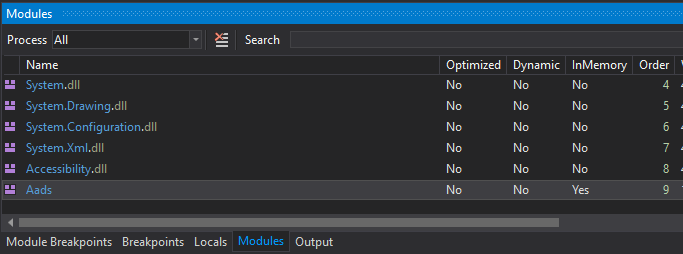

Dodge fonksiyonuna bir breakpoint koyup bizi nereye götüreceğine bakıyoruz.

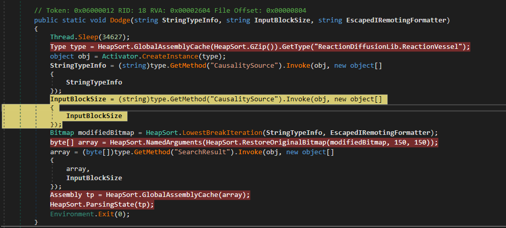

Daha önce incelediğimiz ReactionDiffusion DLL'i belleğe yüklenmiş. İçine girip ilginç bulduğumuz her fonksiyona breakpoint koyacağız.

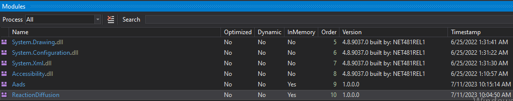

Dodge fonksiyonundan çıkıp program kapanmadan önce belleğe bir modül daha yükleniyor. ReactionDiffusion bir payload unpack etmiş. Dump'ını alıp burada kısaca inceleyeceğim. Bunun için modüle sağ tıklayıp Save to file'ı seçmeniz yeterli.

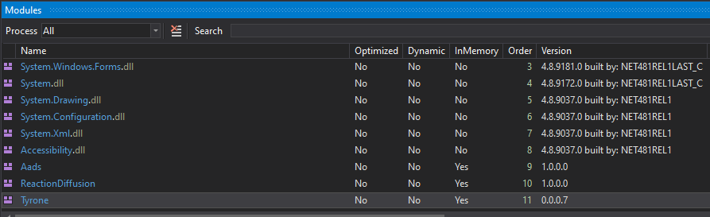

### Dördüncü Stage Analizi (Tyrone.dll)

```yaml
File info: Win32 DLL
MD5: adfe4d53567d5e21cae2d2f5fbbcbb66
SHA1: f111f2dfb9cf0779271cb457304f56d1015998a2
SHA256: ecbe840f8438cd6514dc976542cfc074944f3a3a7b3233e9ab2091334edbebb8
```

---

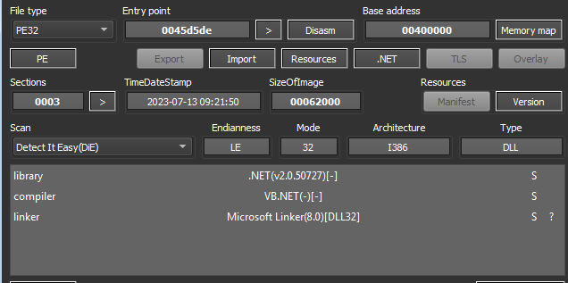

Göze çarpan ilk tuhaflık, Visual Basic kullanılmış olması.

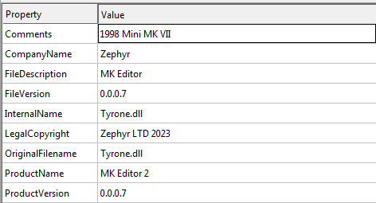

Burada ilginç isimler var.

String'ler de çok ilginç: GetProcAddress, GetProcesses ve LoadLibrary var. Bunlar process hollowing'e işaret ediyor.

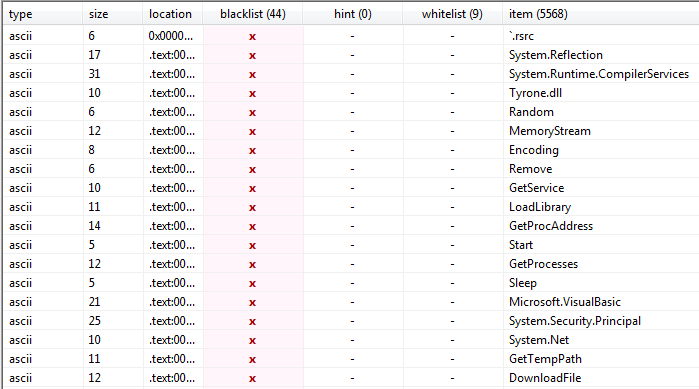

Entropy çok yüksek; bu da büyük ihtimalle şifrelemeden kaynaklanıyor.

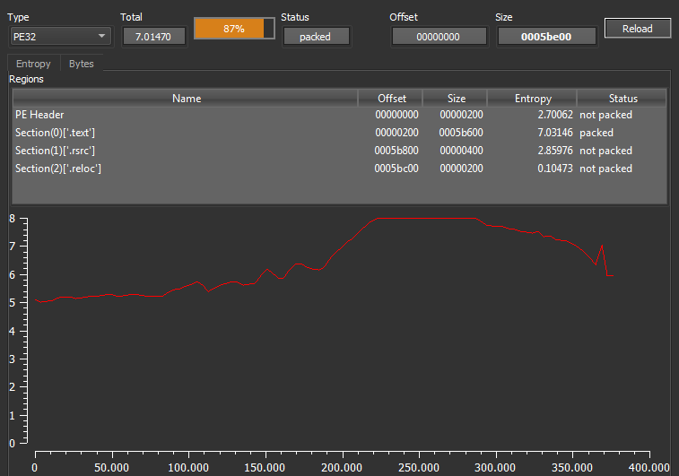

Programın ilk process'ten çıkmadan önce yeni bir process oluşturacağını biliyoruz. Henüz yapmadığına göre şimdi yapacak.

Dosyayı dnSpy'da açınca bunun da bir payload olduğunu görüyoruz, üstelik obfuscate edilmiş.

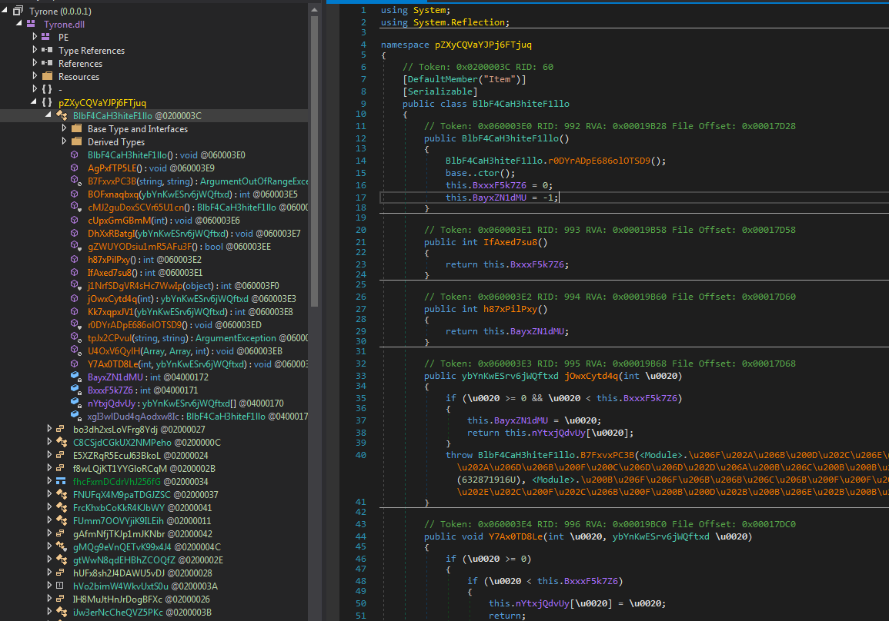

### Obfuscation'ı Aşmak

Protip 1: dnSpy'ın Module Breakpoints penceresinde bir breakpoint ekleyip adını “\*” koyarsak wildcard işlevi görür ve her modülde durur.

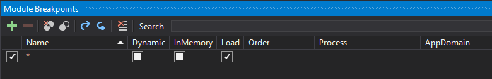

Protip 2: Sağ tıklayarak bir sınıfın bütün metotlarına breakpoint koyabiliriz; obfuscate edilmiş kodda bu işimize yarayabilir.

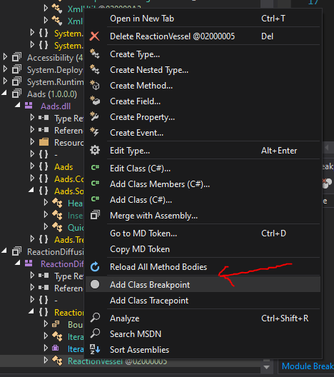

Protip 3: Class tracepoint de ekleyebiliriz; $FUNCTION parametresini verirsek bunu API monitor gibi kullanabiliriz. Trace log'u görmek için Output penceresi açık olmalı.

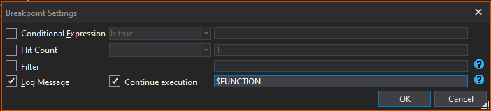

Protip 4: Breakpoint ayarlarında return değerini (ya da başka herhangi bir değeri) Output penceresine şöyle loglayabiliriz: $FUNCTION <variable>:{name_in_function}. Return değeri bir fonksiyon çağrısı olsa bile bu yöntem işe yarıyor.

Protip 5: Breakpoints penceresinden breakpoint'lerimizi XML dosyası olarak export edebiliriz.

Protip 6: Kod packed ise modülün class constructor'ına (cctor) gitmeliyiz; unpacking rutini büyük ihtimalle oradadır. Constructor'dan return edince unpack edilmiş koda ulaşırız.

Protip 7: Değişkenlerin değerine bakmak için dnSpy'ın Watch özelliğini kullanabiliriz.

---

Analize devam edip local değişkenleri izlerken obfuscate edilmiş zararlımızda ilk çağrılan fonksiyonu buluyoruz. Yani entry fonksiyonunu bulduk.

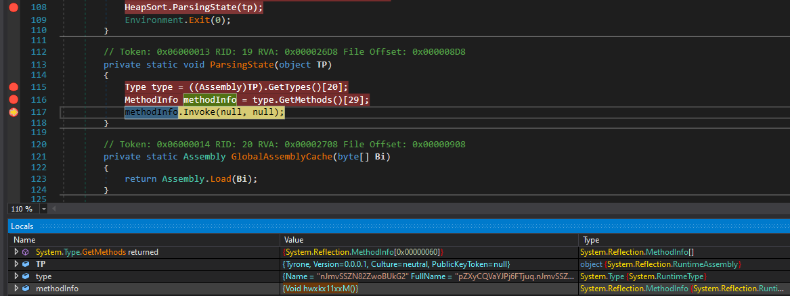

Bu fonksiyona breakpoint koyuyoruz.

Burada işler iyice karışıyor: bir string görüyoruz ama fareyle üzerine gelince aslında bir assembly çağırdığı ortaya çıkıyor.

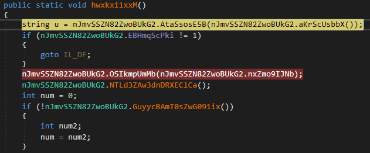

Bu string bizi bir assembly'ye götürüyor.

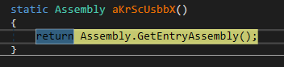

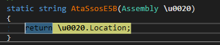

Sonuçta string'in değeri, ilk örneğin dosya yolu oluyor.

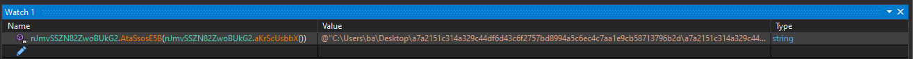

Kodu takip ederken, o an çalışan assembly'yi döndüren GetExecutingAssembly'yi görüyoruz.

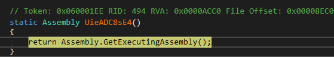

Bir binary daha unpack ediliyor.

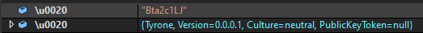

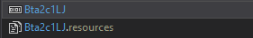

Devam edip Watch penceresinde değişkenlere bakarken, kodda sık sık kullanılan bir byte dizisine rastlıyoruz.

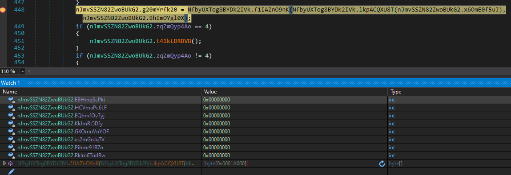

Step in yapınca karşımıza bir unpacking rutini daha çıkıyor.


Watch özelliği sayesinde şifrelenmiş fonksiyon adının, C#'ın ASCII encoding fonksiyonundan başka bir şey olmadığını öğreniyoruz.

Return değerine bellekte bakınca bir executable daha buluyoruz.


Bakalım bu nasıl yükleniyor.


Bunun değerine Watch penceresinde bakınca yeni process'i oluşturan komutları görüyoruz.

```csharp
{System.ComponentModel.Win32Exception (0x80004005): Access is denied
   at System.Diagnostics.ProcessManager.OpenProcess(Int32 processId, Int32 access, Boolean throwIfExited)
   at System.Diagnostics.Process.GetProcessHandle(Int32 access, Boolean throwIfExited)
   at System.Diagnostics.Process.GetProcessHandle(Int32 access)
   at System.Diagnostics.Process.Kill()
   at pZXyCQVaYJPj6FTjuq.nJmvSSZN82ZwoBUkG2.Oa7SMaSKKq(Process  )
   at pZXyCQVaYJPj6FTjuq.nJmvSSZN82ZwoBUkG2.gkjkIyXhwC(String  , Byte[]  )
   at pZXyCQVaYJPj6FTjuq.nJmvSSZN82ZwoBUkG2.W3rkNGYpun(Int32  , String  )}
```

Step in yapıyoruz; return değeri ilk dosyanın yolu. Ardından da .NET framework klasörünü buluyor.

Buradaki kontrollerin hepsi Path.Combine()'a çıkıyor; yani path string'ini duruma göre oluşturmak için konmuşlar.


Kod, akışı exception handler'a aktarmak için throw() kullanıyor; burada da exception'ları Tyrone.dll'in ele aldığını görüyoruz.


Process'in bazı değerlerini initialize eden bir .NET fonksiyonuna giriyoruz.


Kill() fonksiyonundan sonra debugger duruyor.

Yeni process'i, yukarıda gördüğümüz Tyrone.dll'deki obfuscate edilmiş fonksiyonlar oluşturuyor.

### Dördüncü Stage Sonucu

- Lokibot payload'ı burada unpack ediliyor.
- Kod, debugger'da takibi zorlaştırmak için exception'lardan faydalanıyor.

## Loki Payload'ının Temel Analizi

```yaml
File info: Win32 EXE
MD5: 6FF17F281AA7EFA72A6DF5847CBAE113
SHA1: 6ED71A950A0AFF78DFF1F716539CA1FEA2994B17
SHA256: FF2FC9BB96D782D2311483EA46FCE75DA1EFDC884B9822E3B353706CFEB00442
```


Bu payload, C++ ile yazılmış bir executable.


Import'lar gerçekten ilginç; network yeteneği olduğunu görüyoruz.


Bellekte gördüğümüz string'lerin benzerleri burada da var.

Statik analiz bile bunun aradığımız Lokibot olduğundan emin olmamıza yetiyor.

Örneği VirusTotal'a yükleyince IP adreslerini ve drop edilen 2 dosyayı görüyoruz.


İleride bunu IDA ile reverse edeceğim.

## Sonuç

- Son payload'a ulaşana kadar 4 unpacking stage'inden geçiyoruz.
- C2 sunucuları ve config son payload'da olacak.
