## \_start: 

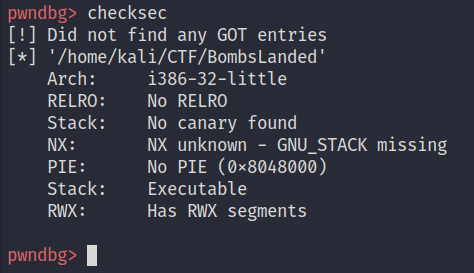

checksec ile baktığımızda PIE'ın kapalı olduğunu görüyoruz. Adres offset'leri aynı kalacağı için disassembler ile debugger'ı yan yana kullanmak kolaylaşacak. Elimizde 32-bit bir binary var.

Global Offset Table da bozulmuş, bu da debug etmeyi zorlaştıracak.

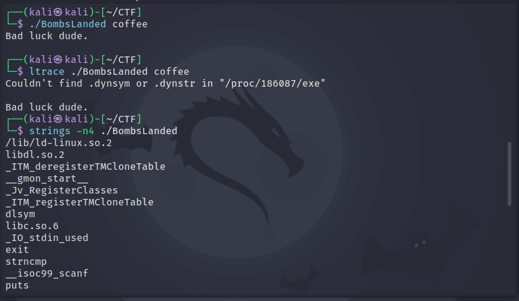

Programı çalıştırınca en ufak bir ipucu bile vermiyor. Ltrace de çalışmıyor; bu da dosyanın statik linklendiğini düşündürüyor, ama birazdan öyle olmadığını göreceğiz.

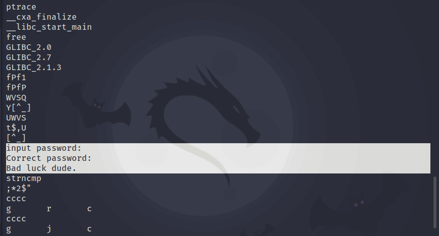

Dikkat çekici birkaç string var. Aralarında debugger'ların bir process'e attach olmak için kullandığı ptrace de var, yani anti-debugging amaçlı kontrolleri bypass etmemiz gerekebilir. Ama bu binary'de hiçbir şey yapmam gerekmedi.

## Tersine Mühendislik 

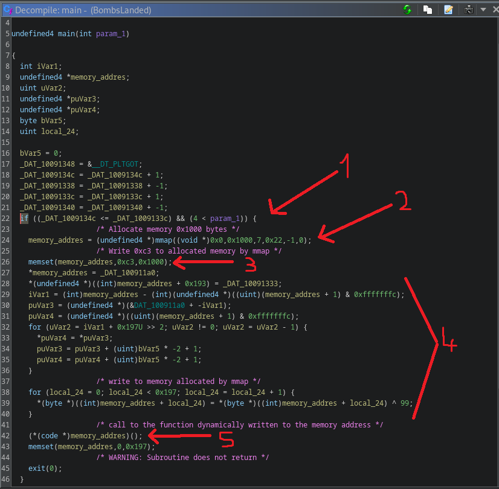

1. Program, 4'ten az komut satırı argümanı verilip verilmediğine bakıyor ve daha önce hazırladığı iki değişkeni karşılaştırıyor. C'de main fonksiyonunun ilk parametresi argüman sayısıdır.
2. İlk olarak mmap çağrılıyor; mmap, ayırdığı bellek bölgesinin başlangıç adresini gösteren bir pointer döndürür. Değişkenin adını memory_address yaptım, kod bir anda çok daha okunur hale geldi.
3. Ardından memset, mmap'in ayırdığı buffer'ı `0xc3` ile dolduruyor. Bu da (malum bir yapay zekâya göre) x86 assembly'de `RET` instruction'ının opcode'u.
4. memory_address değişkenini takip edince, gösterdiği adrese bazı veriler yazıldığını görüyoruz.
5. Sonra da memory_address çağrılıyor. Demek ki yukarıdaki kod, memory_address'in gösterdiği bellek bölgesine bir fonksiyon unpack etmiş.

O bellek bölgesinde ne olduğunu bilmediğimiz için burada yapabileceğimiz başka bir şey yok. Devam etmek için debugger'a geçmemiz gerekiyor.

Ghidra'dan çıkmadan önce diğer fonksiyonlara da göz atmakta fayda var; içlerinden biri dikkatimizi çekmeli: strncmp fonksiyonu.

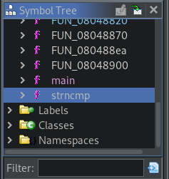

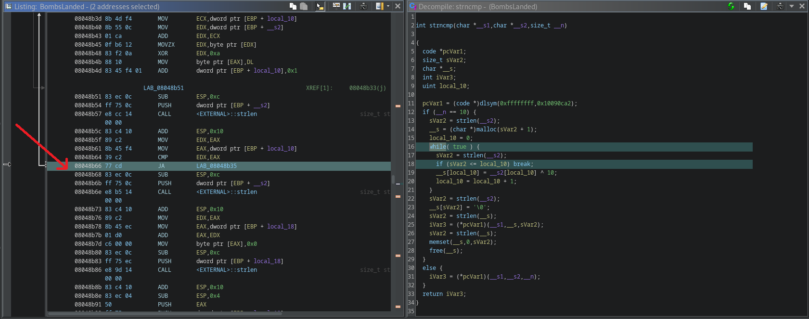

Bunun C'deki bildiğimiz strncmp fonksiyonuyla pek alakası yok. İçinde ilginç bir while döngüsü var; bir string oluşturuyor gibi, büyük ihtimalle de parolayı. Debugger'da daha yakından bakmak için döngü koşulunun offset'ini not alıyoruz.

Şimdilik bu fonksiyonu çağıran bir yer görünmüyor. Bu da, çağrılacaksa çağrının dinamik olarak çözümleneceği anlamına geliyor.

## Debugging 

Başta koymaya değer birkaç breakpoint:

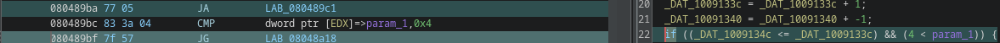

- if ifadesinin ilk koşulu.
- if'i bypass etmek için aynı ifadenin ikinci koşulu.
- strncmp'deki while döngüsü; bize parolayı ele verebilir.

Bu breakpoint'ler parolayı bulmaya yetmezse memory_address çağrısına da breakpoint koyup step-into yapmamız gerekebilir.

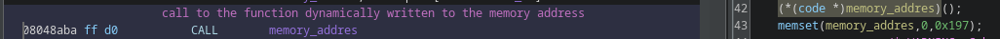

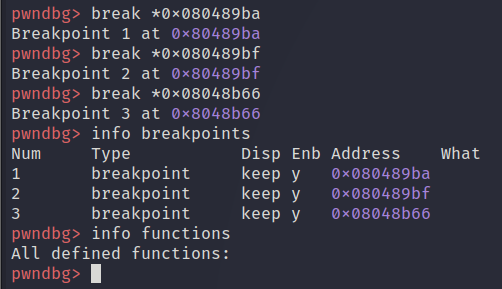

Fonksiyon isimleri tabii ki yok.

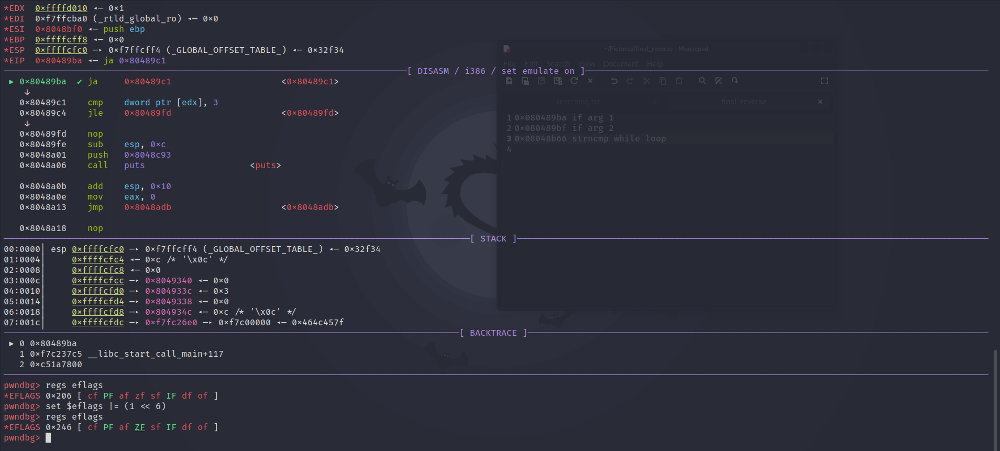

İlk kontrol bir JA; bunu bypass etmek için ZF'yi set etmemiz gerekiyor. İkinci kontrol olan JG'de de sign flag'i tersine çevirmek yetiyor, böylece iki kontrolü de geçiyoruz. gdb ve koşullu jump'larla ilgili daha fazla bilgi için aşağıya birkaç kaynak bırakıyorum.

[https://cheatography.com/superkojiman/cheat-sheets/gdb-pwndbg/](https://cheatography.com/superkojiman/cheat-sheets/gdb-pwndbg/)

[https://www.philadelphia.edu.jo/academics/qhamarsheh/uploads/Lecture 18 Conditional Jumps Instructions.pdf](https://www.philadelphia.edu.jo/academics/qhamarsheh/uploads/Lecture%2018%20Conditional%20Jumps%20Instructions.pdf)

Program bizden parola istiyor. Herhangi bir şey girince, tahmin ettiğimiz gibi üçüncü breakpoint'e düşüyoruz. Devam edip art arda enter'a bastıkça parolanın stack'te adım adım oluştuğunu görüyoruz.

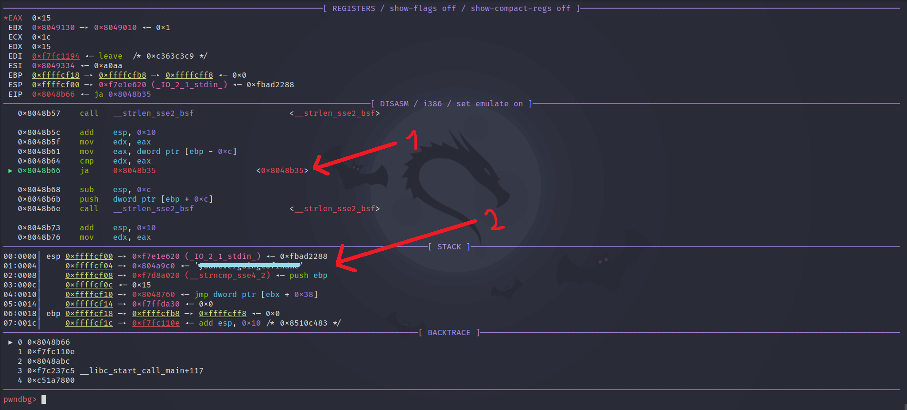

1. Üçüncü breakpoint'e düştük.
2. Stack'te bir string oluşturuluyor.

Son olarak bulduğumuz parolayı deniyoruz. İlk kontrolü geçmek için binary'yi 4'ten fazla argümanla çalıştırmamız gerekiyor. Aslında 4 argüman da yeterdi, çünkü C'de main fonksiyonunun ilk argümanı programın adıdır.

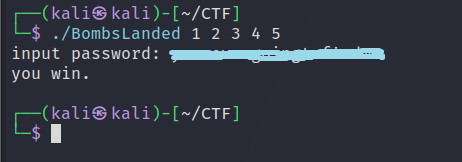

Kazandık…
